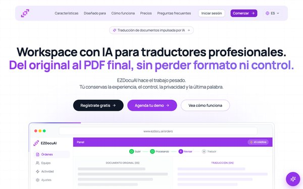
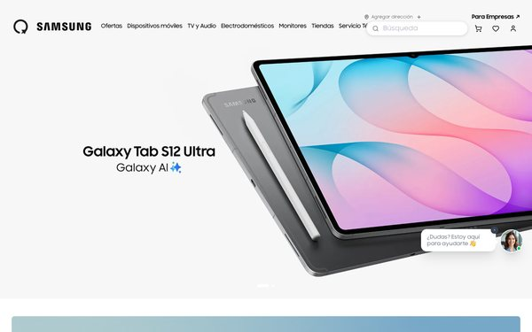
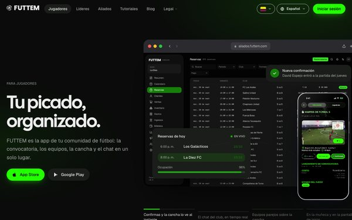
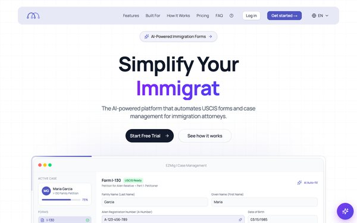
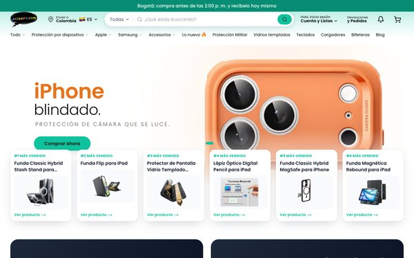
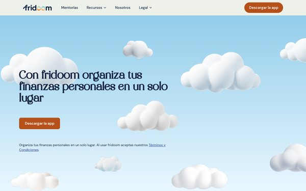
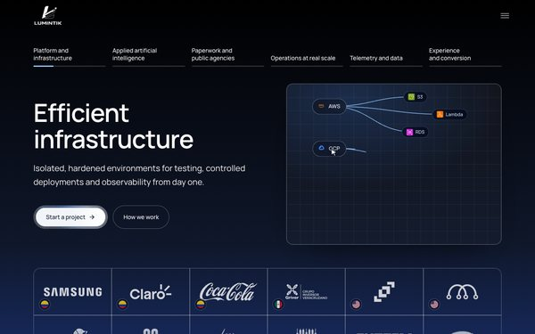

<picture>
  <source media="(prefers-color-scheme: dark)" srcset="assets/banner-dark.svg">
  
</picture>

I build web and mobile apps, document AI and AI powered SaaS that reach production, from the architecture to the deployment. Cofounder at [Lumintik](https://www.lumintik.com), a software studio shipping for clients in Colombia, Mexico and the United States. I work with Claude Code every day.

**Top 10 in Colombia by GitHub contributions.** 12,767 in the last 12 months, which would rank **#7 in Colombia** by the numbers of [committers.top](https://committers.top/colombia_private) (public + private list, Oct 16, 2026).

**Work, discipline and consistency:** contributions on **358 of 368 days** and in **every single week** of the year. Longest streak: 90 days.

[Email](mailto:andreyplazas77@gmail.com) &nbsp;·&nbsp; [LinkedIn](https://www.linkedin.com/in/andrey-steven-plazas-torres-4b8279192/)

<picture>
  <source media="(prefers-color-scheme: dark)" srcset="https://streak-stats.demolab.com/?user=ANDREYPLAZAST&theme=dark&hide_border=true&background=0D1117">
  
</picture>

### Selected work

**[EZDocuAI](https://www.ezdocu.ai)** &nbsp;🇺🇸 🇨🇴  
AI workspace for translating and laying out official documents, used by translation agencies and sworn translators. Scanned and digital documents come out translated in Word, PDF and HTML, keeping the original layout or a jurisdiction format, with a public REST API and term sets that learn from each translator.  
[ezdocu.ai](https://www.ezdocu.ai)

&nbsp; Claude · Gemini · Textract · OnlyOffice · Stripe

 
 

**[iMagiQ, Samsung Store Colombia](https://www.imagiq.com)** &nbsp;🇨🇴  
Online store, in store kiosk and admin dashboard on NestJS microservices, with local payments, shipping and an AI product categorizer.  
[imagiq.com](https://www.imagiq.com)

 
 

**[FUTTEM](https://www.futtem.com)** &nbsp;🇨🇴  
Amateur football app on iPhone, iPad, Apple Watch and Android, live in both stores: games, teams, payments, chat and real time.  
[App Store](https://apps.apple.com/app/futtem/id6739542468) &nbsp;·&nbsp; [Google Play](https://play.google.com/store/apps/details?id=com.futtem.app)

 
 

**[EZMig](https://www.ezmig.ai)** &nbsp;🇺🇸  
Immigration case management with AI form filling, passport reading and real time collaborative editing.  
[ezmig.ai](https://www.ezmig.ai)

 
 

**[Accesify](https://www.accesify.com)** &nbsp;🇨🇴  
Phone accessories ecommerce with installment payments, on its own store and Mercado Libre.  
[accesify.com](https://www.accesify.com)

&nbsp; Medusa

 
 

**[Fridoom](https://fridoom.com)** &nbsp;🇨🇴  
Personal finance app that organizes net worth and investments in one place, with its own landing site.  
[fridoom.com](https://fridoom.com)

&nbsp; Expo

 
 

**[Lumintik](https://www.lumintik.com)** &nbsp;🇨🇴 🇲🇽 🇺🇸  
Software studio: infrastructure, applied AI and automation for clients in Colombia, Mexico and the United States.  
[lumintik.com](https://www.lumintik.com)

&nbsp; Kong · WebSockets

 
 

### Stack

**AI:** Claude · Gemini · DeepL · Textract · Document AI
